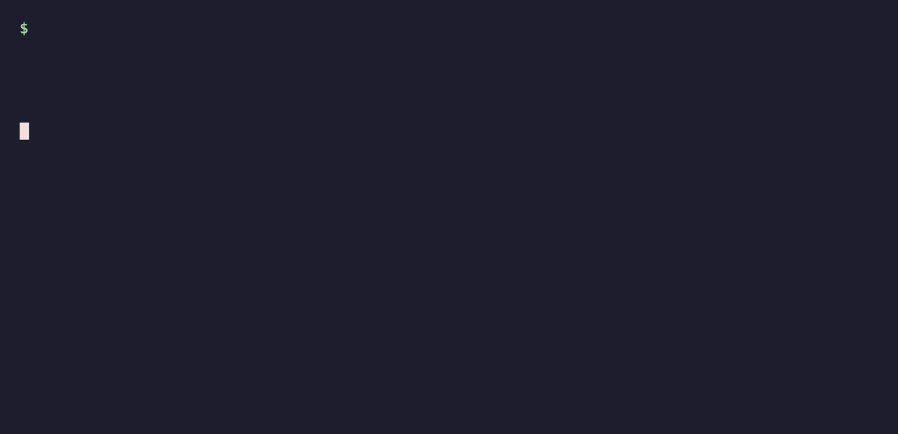
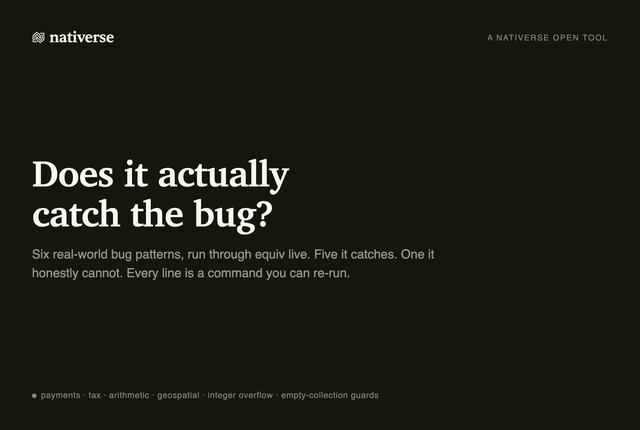

# equiv

**"It's just a refactor." Prove it.**

`equiv` runs your old and new code side by side on hundreds to thousands of generated inputs. Same
behaviour: the check passes. Anything different: the merge is blocked, with the
exact input that shows it. It works the same whether you rewrote the function or
an AI did.

Every verdict comes with a receipt. Run the same check again on any machine
with the same Python version and you get the same receipt, byte for byte. There is no model's opinion involved.



## What it is good at, and what it skips

`equiv` checks **plain Python functions**: ones that take simple values
(`int`, `str`, `float`, `bool`, `dict`, `list[int]`, `list[str]`) and return a result.

On those, it aims never to raise a false alarm. Across the 44 rewrites in our
test corpus that do keep behaviour, it has raised none.

Anything it cannot judge fairly is listed as **not checked**, never shown as a
pass. That includes:

- methods on classes, async functions and nested functions
- functions whose answer depends on maths-library rounding (`sin`, `exp`, `log`, `pow`)
- return values it cannot compare reliably (sets, custom objects)

A pass means "no difference found on the inputs tried". It does not mean the
code is correct or does what you intended.

**Use it where behaviour must not change**: refactors, speed-ups, AI-written
rewrites, and ports (for example a Python function and its Rust or C twin).
There, any difference is a mistake, and the input `equiv` prints is the bug.
It is not a general bug finder for feature work: when a pull request changes
behaviour on purpose, `equiv` can only tell you that it changed.

## Does it actually catch bugs?

- **Test corpus.** 137 labelled pairs of functions where we already know the
  answer. Of the 93 that really change behaviour, `equiv` catches 85, misses 5,
  and cannot check 3. Of the 44 that keep behaviour, it raises 0 false alarms
  (43 pass, 1 cannot check). Each case it misses or cannot check is listed with
  the reason. [`divergences/`](divergences/)
- **[jellyfish](docs/case-studies/jellyfish.md).** This library ships every
  function twice, once in Rust and once in Python. `equiv` finds the two
  disagreeing in 8 of 10 functions. It also catches a bug that shipped in
  version 1.2.1 and was later fixed.
- **[rapidfuzz](docs/case-studies/rapidfuzz.md)** (about 116M downloads a month).
  Its C++ and Python versions score text differently when it contains a
  non-breaking space.
- **Real regressions from project history (the limit).** We traced 713
  regressions that 57 Python projects shipped and later fixed. In only 6 was the
  broken function one `equiv` can check (a module-level function with supported
  type hints that existed before the change). On the one we could confirm end to
  end, `equiv` (and CrossHair) flagged the change but showed the change the
  author intended, not the bug. That is why the Action below gates refactor and
  port PRs, not every PR.
- **Six common refactor mistakes**, run live. Five caught with the exact input,
  one honestly missed. [`examples/scenarios/`](examples/scenarios/)



## Use it on refactor and port PRs

Add `.github/workflows/equiv-review.yml`, and label pull requests that are meant
to keep behaviour with `refactor`:

```yaml
on:
  pull_request:
    types: [opened, synchronize, reopened, labeled]
permissions: { contents: read, pull-requests: write, id-token: write }
jobs:
  review:
    runs-on: ubuntu-latest
    steps:
      - uses: actions/checkout@v4
        with: { fetch-depth: 0, persist-credentials: false }
      - uses: Neelagiri65/equiv@v0.31.0
        with: { keyless: "true", only-label: "refactor" }
```

On a `refactor` PR, `equiv` finds the changed functions, checks each one against
its version on the base branch, and posts one comment. Besides its own generated
inputs, it tries the literal values your tests and other code already call each
function with (read, never run):

- **behaviour preserved**: the check passes
- **behaviour changed**: the check fails and blocks the merge, and the comment shows the input that tells the two apart
- **not checked**: listed with the reason (for example, a parameter needs a type hint)

PRs without the label are skipped.

Other ways to run it:

- **List the functions that must not change** in `.equiv-review` at the repo root,
  one per line: `src/math.py : total : int`. A divergence in a listed function
  blocks the merge on every PR. Good for ports and parity code.
- **Keep a port and its reference in step**: in the same file, add
  `twin : fast.py : slow.py : parse : str` to check a function in two files of the
  PR (for example a Rust binding and the pure-Python version) against each other
  on every PR. Add `: errors-agree` or `: same-host` at the end of the line when
  needed (see [docs/scope.md](docs/scope.md)).
- **No label, no manifest**: `equiv` reviews every changed function and reports
  divergences in the comment **without blocking**, because in an ordinary PR most
  changes are intended. Set `fail-on-divergence: "true"` to block anyway.

Pin a released tag (`@v0.31.0`), not `@main`, so results do not change under you.

## Use it from the command line

```
curl --proto '=https' --tlsv1.2 -LsSf \
  https://github.com/Neelagiri65/equiv/releases/latest/download/equiv-cli-installer.sh | sh

equiv review new.py old.py <function> <arg types>
equiv verify-receipt <signed-receipt-hex>
```

Exit codes: `0` same behaviour, `1` different (the input is printed), `2` could
not check.

## Use it in Claude Code

Install the binary (above), then the plugin:

```
/plugin marketplace add Neelagiri65/equiv
/plugin install equiv@equiv
```

After every edit of a tracked `.py` file, the agent is told whether the
functions that changed still behave as they did at the last commit, and it gets
`review` and `check` as tools. The plugin is configuration only: it needs
equiv 0.30.0 or later on PATH. Without it nothing is checked, and on macOS,
Linux and Windows with Git Bash the agent is told so when the session starts. To set up one project without the plugin, run
`equiv init claude-code` in it.
[Details](docs/agents.md) · [The plugin](plugins/equiv/README.md)

## Good to know

- **The code being checked gets a short list of environment variables, not a
  sandbox.** Since v0.16.0 the signing key, `GH_TOKEN` and the Actions login
  token are not in its environment. It still runs as the same user as the job,
  with normal file and network access, so it can read what that user can read
  (for example a token left in `.git/config`; set `persist-credentials: false`
  on `actions/checkout`, as above). Only review code you would be willing to
  run. [Details](docs/signing-model.md)
- **No tracking.** `equiv` sends nothing anywhere. Optional local counts can be
  switched on with `EQUIV_METRICS=on`. [Details](docs/metrics.md)
- **Same answer everywhere.** Inputs and verdicts are worked out in Rust from a
  fixed seed. Python only runs the functions. Receipts can be signed with your
  own key or with Sigstore, which needs no stored key.

## More detail

- [How inputs are chosen, limits and budgets](docs/scope.md)
- [How receipts are signed](docs/signing-model.md)
- [For coding agents: the MCP server, the after-edit hook and the plugin](docs/agents.md)
- [Releasing](docs/RELEASING.md)

License: Apache-2.0.
